# Guía 8: migración inicial a JSF y Managed Beans

> Versión Word con las capturas integradas:
> [`guia8-jsf-managed-beans.docx`](guia8-jsf-managed-beans.docx).

## 1. Objetivo

Migrar el CRUD de clientes de Servlet/JSP a una primera versión con JavaServer
Faces (JSF), manteniendo la misma capa de persistencia JDBC de las guías
anteriores. También se agrega una vista JSF de solo lectura para los tickets,
reutilizando `TicketDetalleDTO` y la consulta JOIN de la Guía 7.

El resultado debe permitir:

- Listar clientes.
- Registrar un cliente nuevo.
- Editar un cliente existente.
- Desactivar lógicamente un cliente (`activo = 0`) y volver a activarlo.
- Mostrar mensajes de éxito y error.
- Validar campos obligatorios y correo único.
- Consultar tickets sin modificar la base de datos.
- Comparar el enfoque Servlet/JSP con JSF.
- Comprobar que los datos persisten después de reiniciar Tomcat.

## 2. Entorno y decisión técnica

| Elemento | Versión / decisión |
|---|---|
| Servidor | Apache Tomcat 9.0.120 |
| Java de ejecución | JDK 25 |
| Nivel de compilación | Java 8 (`source/target 1.8`) |
| Base de datos | MySQL 8.0.37 |
| Persistencia | JDBC con MySQL Connector/J 8.0.33 |
| JSF | Mojarra 2.3.21 (`javax.faces.*`) |
| CDI | Weld Servlet 3.1.9 (`@Named`, `@ViewScoped`) |
| Vistas | Facelets/XHTML con JSF 2.3 |
| Módulo anterior | Servlet/JSP se conserva temporalmente |

### ¿Por qué no se usó JSF 4?

Tomcat 9 implementa las APIs `javax.*` (Servlet 4.0, JSP 2.3, EL 3.0). JSF 4
y Jakarta Faces 4 usan paquetes `jakarta.faces.*`, namespaces como
`jakarta.faces.html` y requieren Tomcat 10.1 o un servidor Jakarta EE 9+.

Por eso se eligió **Mojarra 2.3.21**, que:

- Usa `javax.faces.*`.
- Es compatible con Tomcat 9.
- Usa los namespaces `http://xmlns.jcp.org/jsf/html` y
  `http://xmlns.jcp.org/jsf/core`.
- Permite `@ViewScoped`, `h:dataTable`, `h:messages` y Facelets 2.3.

### ¿Por qué Weld?

La guía pide `@Named`, `@ViewScoped` y `@PostConstruct`. `@Named` y
`@ViewScoped` son anotaciones CDI, y Tomcat 9 no incluye un contenedor CDI
completo. Se agregó **Weld Servlet 3.1.9** para proporcionar CDI 2.0 con
paquetes `javax.enterprise.*` y `javax.inject.*`.

La alternativa habría sido usar `@ManagedBean` de JSF y
`javax.faces.bean.ViewScoped`, pero se prefirió mantener el enfoque CDI de la
guía.

## 3. Dependencias agregadas

En `pom.xml`:

```xml
<properties>
    <mojarra.version>2.3.21</mojarra.version>
    <weld.version>3.1.9.Final</weld.version>
</properties>

<dependencies>
    <!-- API Jakarta EE 8 en alcance provided: aporta javax.* para compilar. -->
    <dependency>
        <groupId>jakarta.platform</groupId>
        <artifactId>jakarta.jakartaee-api</artifactId>
        <version>8.0.0</version>
        <scope>provided</scope>
    </dependency>

    <!-- Implementación JSF 2.3 con paquetes javax.faces.* -->
    <dependency>
        <groupId>org.glassfish</groupId>
        <artifactId>jakarta.faces</artifactId>
        <version>${mojarra.version}</version>
    </dependency>

    <!-- CDI 2.0 para Tomcat 9 -->
    <dependency>
        <groupId>org.jboss.weld.servlet</groupId>
        <artifactId>weld-servlet-shaded</artifactId>
        <version>${weld.version}</version>
    </dependency>
</dependencies>
```

El WAR termina con estas librerías relevantes en `WEB-INF/lib`:

```text
jakarta.faces-2.3.21.jar
weld-servlet-shaded-3.1.9.Final.jar
mysql-connector-j-8.0.33.jar
jstl-1.2.jar
```

`jakarta.jakartaee-api` no se empaqueta porque tiene alcance `provided`.

## 4. Configuración de JSF

### 4.1 `WEB-INF/web.xml`

Se registra `FacesServlet` y se mapea a `*.xhtml`:

```xml
<context-param>
    <param-name>javax.faces.PROJECT_STAGE</param-name>
    <param-value>Development</param-value>
</context-param>

<servlet>
    <servlet-name>Faces Servlet</servlet-name>
    <servlet-class>javax.faces.webapp.FacesServlet</servlet-class>
    <load-on-startup>1</load-on-startup>
</servlet>
<servlet-mapping>
    <servlet-name>Faces Servlet</servlet-name>
    <url-pattern>*.xhtml</url-pattern>
</servlet-mapping>
```

`Development` facilita los mensajes de diagnóstico de Mojarra. En producción
se puede cambiar a `Production`.

### 4.2 `WEB-INF/faces-config.xml`

Se usa una regla explícita para ir de la portada a las vistas de clientes y
tickets:

```xml
<faces-config version="2.3"
    xmlns="http://xmlns.jcp.org/xml/ns/javaee">

    <navigation-rule>
        <from-view-id>/index.xhtml</from-view-id>

        <navigation-case>
            <from-outcome>clientes</from-outcome>
            <to-view-id>/views/clientes/lista.xhtml</to-view-id>
            <redirect/>
        </navigation-case>

        <navigation-case>
            <from-outcome>tickets</from-outcome>
            <to-view-id>/views/tickets/lista.xhtml</to-view-id>
            <redirect/>
        </navigation-case>
    </navigation-rule>
</faces-config>
```

### 4.3 `WEB-INF/beans.xml`

Weld descubre los beans anotados:

```xml
<beans xmlns="http://xmlns.jcp.org/xml/ns/javaee"
       version="2.0"
       bean-discovery-mode="annotated">
</beans>
```

El modo `annotated` descubre `ClienteBean` y `TicketBean` porque tienen
`@Named` y un scope como `@ViewScoped`.

## 5. Modelo y serialización

### 5.1 `Cliente`

`ClienteBean` es un bean de vista. La especificación de `@ViewScoped` permite
que el bean se pasive; por eso el modelo debe ser serializable.

Cambios realizados:

```java
public class Cliente implements Serializable {

    private static final long serialVersionUID = 1L;

    // ...

    public Cliente(Cliente otro) {
        this(otro == null ? null : otro.idCliente,
                otro == null ? null : otro.nombre,
                otro == null ? null : otro.correo,
                otro != null && otro.activo);
    }
}
```

El constructor copia evita que el formulario modifique directamente el objeto
que está en la lista.

### 5.2 `TicketDetalleDTO`

También se hizo serializable porque `TicketBean` es `@ViewScoped` y mantiene
una lista de DTO:

```java
public class TicketDetalleDTO implements Serializable {

    private static final long serialVersionUID = 1L;

    // ...
}
```

## 6. Managed Beans

### 6.1 `ClienteBean`

Ubicación:

```text
src/main/java/sv/edu/itca/servicedesk360/bean/ClienteBean.java
```

Anotaciones principales:

```java
@Named("clienteBean")
@ViewScoped
public class ClienteBean implements Serializable {

    private static final long serialVersionUID = 1L;

    private Cliente cliente;
    private List<Cliente> clientes;
    private Long idSeleccionado;

    /*
     * El DAO no se serializa con la vista. Se reconstruye de forma perezosa
     * después de una activación de sesión.
     */
    private transient ClienteDAO clienteDAO;

    @PostConstruct
    public void init() {
        LOG.info("ClienteBean @PostConstruct: inicializando vista de clientes");
        clienteDAO = new ClienteDAOImpl();
        nuevo();
        cargarClientes();
    }
}
```

#### ¿Qué significa cada anotación?

- `@Named("clienteBean")`: expone el bean a Expression Language con el nombre
  `#{clienteBean}`. Es una anotación CDI (`javax.inject.Named`).
- `@ViewScoped`: el bean vive mientras el usuario interactúa con la misma
  vista. Es más corto que `@SessionScoped` y evita compartir datos entre
  pestañas o vistas distintas.
- `@PostConstruct`: método que JSF/CDI ejecuta después de crear el bean y
  aplicar la inyección. Aquí se crea el DAO, se prepara un cliente vacío y se
  carga la lista.
- `Serializable`: el scope de vista es pasivante; el bean y sus datos deben
  poder serializarse si el servidor decide pasivar la sesión.

#### ¿Dónde está el SQL?

En ningún método del bean. El bean usa la interfaz `ClienteDAO` y la
implementación `ClienteDAOImpl`. Las consultas SQL siguen en la capa DAO.

#### Operaciones implementadas

| Método | Acción |
|---|---|
| `cargarClientes()` | Lista todos los clientes. |
| `nuevo()` | Prepara un cliente vacío y activo. |
| `irNuevo()` | Navega al formulario con `faces-redirect=true`. |
| `guardar()` | Valida, inserta o actualiza, y vuelve al listado. |
| `editar(Cliente)` | Guarda el id seleccionado y navega a `formulario?id=...`. |
| `desactivar(Cliente)` | Cambia `activo` a `false`. |
| `activar(Cliente)` | Cambia `activo` a `true`. |
| `cargarFormulario()` | Carga el cliente desde MySQL usando el `id` de la URL. |

#### Validación y mensajes

```java
public String guardar() {
    if (cliente == null) {
        Mensajes.error("No hay datos del cliente para guardar.");
        return null;
    }

    String nombre = limpiar(cliente.getNombre());
    String correo = limpiar(cliente.getCorreo());

    if (nombre.length() < 3
            || !correo.matches("^[^@\\s]+@[^@\\s]+\\.[^@\\s]+$")) {
        Mensajes.error("Revise nombre y correo.");
        return null;
    }

    Long id = cliente.getIdCliente();
    try {
        if (dao().existeCorreo(correo, id)) {
            Mensajes.error("El correo ya está registrado.");
            return null;
        }

        // Inserta si id es null/0; actualiza si ya existe.
        // ...
        return "lista?faces-redirect=true";
    } catch (DAOException ex) {
        Mensajes.error("No fue posible guardar el cliente.");
        return null;
    }
}
```

`Mensajes` agrega un `FacesMessage` global y activa
`Flash.setKeepMessages(true)` para que el mensaje sobreviva al redirect:

```java
contexto.addMessage(null, new FacesMessage(severidad, texto, null));
contexto.getExternalContext().getFlash().setKeepMessages(true);
```

### 6.2 `TicketBean`

```java
@Named("ticketBean")
@ViewScoped
public class TicketBean implements Serializable {

    private List<TicketDetalleDTO> tickets;
    private transient TicketDAO ticketDAO;

    @PostConstruct
    public void init() {
        ticketDAO = new TicketDAOImpl();
        cargar();
    }

    public void cargar() {
        tickets = dao().listarDetalle(null, null, 20, 0);
    }
}
```

No hay SQL nuevo. La consulta JOIN está en `TicketDAOImpl` desde la Guía 7.

## 7. Vistas XHTML

### 7.1 `index.xhtml`

Portada JSF con dos botones:

```xml
<h:form>
    <h:commandButton value="Abrir clientes (JSF)"
                     action="clientes"
                     styleClass="boton"/>
    <h:commandButton value="Ver tickets (solo lectura)"
                     action="tickets"
                     styleClass="boton"/>
</h:form>
```

Los outcomes `clientes` y `tickets` son resueltos por
`faces-config.xml`.

### 7.2 `views/clientes/lista.xhtml`

Usa `h:dataTable`, `h:column`, `f:facet`, `h:messages` y un formulario por
fila para las acciones:

```xml
<h:messages globalOnly="true" layout="list"/>

<h:dataTable value="#{clienteBean.clientes}"
             var="c"
             rendered="#{not empty clienteBean.clientes}"
             styleClass="tabla-jsf">

    <h:column>
        <f:facet name="header">Nombre</f:facet>
        #{c.nombre}
    </h:column>

    <h:column>
        <f:facet name="header">Acciones</f:facet>
        <h:form>
            <h:commandButton value="Editar"
                             action="#{clienteBean.editar(c)}"/>
            <h:commandButton value="Desactivar"
                             action="#{clienteBean.desactivar(c)}"
                             rendered="#{c.activo}"/>
            <h:commandButton value="Activar"
                             action="#{clienteBean.activar(c)}"
                             rendered="#{not c.activo}"/>
        </h:form>
    </h:column>
</h:dataTable>
```

Si no hay clientes se muestra un mensaje de estado vacío.

### 7.3 `views/clientes/formulario.xhtml`

El formulario usa `required` para que JSF ejecute la validación antes de
invocar `guardar()`:

```xml
<f:metadata>
    <f:viewParam name="id" value="#{clienteBean.idSeleccionado}"/>
    <f:viewAction action="#{clienteBean.cargarFormulario}"/>
</f:metadata>

<h:form id="formCliente">
    <h:messages layout="list"/>

    <h:inputText id="nombre"
                 value="#{clienteBean.cliente.nombre}"
                 required="true"
                 requiredMessage="El nombre es obligatorio."
                 maxlength="120"/>

    <h:inputText id="correo"
                 value="#{clienteBean.cliente.correo}"
                 required="true"
                 requiredMessage="El correo es obligatorio."
                 maxlength="160"/>

    <h:selectBooleanCheckbox id="activo"
                             value="#{clienteBean.cliente.activo}"/>
</h:form>
```

### 7.4 `views/tickets/lista.xhtml`

Tabla de solo lectura con ID, cliente, equipo, categoría, técnico, título,
prioridad y estado. Se alimenta de `#{ticketBean.tickets}`.

## 8. Navegación, redirect y estado

La guía original propone `faces-redirect=true`. Se usó ese patrón, pero con
dos adaptaciones necesarias para que funcione en Tomcat:

1. Las vistas están en `/views`, no en `/WEB-INF/views`. Si una vista está
   bajo `WEB-INF`, JSF genera el `action` del formulario apuntando a
   `/WEB-INF/...`; el navegador hace el POST a esa ruta y Tomcat responde
   404. Las vistas públicas permiten que el postback llegue a `FacesServlet`.
2. Para editar no se depende de un objeto guardado en el bean antes del
   redirect. Se envía `?id=7`, `f:viewParam` enlaza el id y `f:viewAction`
   carga el cliente desde MySQL. Así el estado no se pierde al cambiar de
   vista.

Flujo real:

```text
index.xhtml
  -> action="clientes"
  -> redirect a /views/clientes/lista.xhtml

lista.xhtml
  -> Nuevo cliente:   /views/clientes/formulario.xhtml
  -> Editar cliente:  /views/clientes/formulario.xhtml?id=7
  -> Guardar:         /views/clientes/lista.xhtml
  -> Desactivar:      misma vista, se recarga la tabla
```

## 9. Ciclo de vida observado

Con `@PostConstruct` y `java.util.logging` se registran estos hitos:

```text
ClienteBean @PostConstruct: inicializando vista de clientes
ClienteBean.cargarClientes: 5 registros
ClienteBean.cargarFormulario id=7
ClienteBean.guardar id=7
ClienteBean.editar id=7
ClienteBean.cambiarEstado id=7 activo=false
TicketBean @PostConstruct: inicializando vista de tickets
TicketBean.cargar: 2 registros
```

Extracto real del log de Tomcat durante la validación:

```text
15-Nov-2026 19:13:33.144 INFO [main] org.jboss.weld.bootstrap.WeldStartup.<clinit>
WELD-000900: 3.1.9 (Final)
15-Nov-2026 19:13:34.094 INFO [main] com.sun.faces.config.ConfigureListener.contextInitialized
Initializing Mojarra 2.3.21 for context '/ServiceDesk360'
15-Nov-2026 19:13:37.234 INFO [http-nio-8080-exec-2]
sv.edu.itca.servicedesk360.bean.ClienteBean.init
ClienteBean @PostConstruct: inicializando vista de clientes
15-Nov-2026 19:13:37.645 INFO [http-nio-8080-exec-2]
sv.edu.itca.servicedesk360.bean.ClienteBean.cargarClientes
ClienteBean.cargarClientes: 5 registros
```

Secuencia simplificada de un postback de JSF:

1. Restaurar la vista.
2. Aplicar los valores enviados (`h:inputText`).
3. Ejecutar conversión y validación (`required`, formato, etc.).
4. Actualizar el modelo (`#{clienteBean.cliente.nombre}`).
5. Invocar la acción (`guardar()`), solo si la validación pasó.
6. Navegar y renderizar la nueva vista.

Esto explica por qué al enviar el formulario vacío se muestran:

```text
El nombre es obligatorio.
El correo es obligatorio.
```

y **no** se ejecuta el `INSERT`. La validación ocurre antes de la fase de
invocación de la acción.

## 10. Comparación Servlet/JSP vs JSF

| Aspecto | Servlet/JSP (Guía 6) | JSF (Guía 8) |
|---|---|---|
| Controlador | `ClienteServlet` con `doGet`/`doPost` y parámetro `accion`. | Métodos de acción de `ClienteBean`. |
| Vista | JSP + JSTL (`c:forEach`, `c:out`). | XHTML + Facelets (`h:dataTable`, `h:outputText`). |
| Navegación | `sendRedirect` y `RequestDispatcher.forward`. | Outcomes, `faces-config.xml` y `faces-redirect=true`. |
| Estado | Atributos de request y sesión. | `@ViewScoped` + `f:viewParam`. |
| Validación | `if`, expresiones regulares y `IllegalArgumentException`. | `required`, convertidores y validación en el bean. |
| Mensajes | `flashError`/`flash` en sesión y JSP. | `FacesMessage` + `Flash`. |
| Formularios | HTML manual + JSP. | Componentes `h:form`, `h:inputText`, `h:selectBooleanCheckbox`. |
| Tabla | `c:forEach` generando `<tr>` y `<td>`. | `h:dataTable` y `h:column`. |
| Persistencia | DAO invocado desde el Servlet. | DAO invocado desde el bean; el bean no contiene SQL. |
| URL de clientes | `/clientes`. | `/views/clientes/lista.xhtml`. |
| Ventaja principal | Control explícito y flujo fácil de seguir. | Menos HTML repetitivo, estado de vista y componentes reutilizables. |
| Costo principal | Más código manual y lógica repetida. | Configuración de JSF/CDI y ciclo de vida más complejo. |

**Conclusión de la comparación:** ambos módulos reutilizan el mismo modelo y
DAO. JSF reduce el código de presentación y facilita el estado de la vista,
pero exige entender el ciclo de vida, la navegación y el empaquetado de las
dependencias. El Servlet se conserva para comparar y como respaldo funcional.

## 11. Pruebas realizadas

| Prueba | Resultado |
|---|---|
| `mvn clean package -DskipTests` | `BUILD SUCCESS` |
| Arranque de Tomcat | Weld 3.1.9 y Mojarra 2.3.21 inicializan sin errores de despliegue |
| `GET /index.xhtml` | HTTP 200; portada JSF |
| `GET /views/clientes/lista.xhtml` | HTTP 200; tabla de clientes |
| Alta de cliente | Cliente id 7, “Cliente JSF Demo” |
| Correo duplicado | “El correo ya está registrado.”; no se inserta |
| Campos vacíos | “El nombre es obligatorio.” y “El correo es obligatorio.”; no se ejecuta `guardar()` |
| Edición | Nombre actualizado a “Cliente JSF Demo Editado”; mensaje de éxito |
| Desactivación lógica | `activo = 0`; botón cambia a “Activar” |
| Reactivación | `activo = 1`; botón vuelve a “Desactivar” |
| Tickets JSF | Tabla con los tickets 9 y 10; datos del JOIN de la Guía 7 |
| Reinicio de Tomcat | El cliente id 7 sigue apareciendo en el listado |
| Consulta JDBC de comprobación | `7 \| Cliente JSF Demo Editado \| cliente.jsf.demo@demo.local \| 1` |

### Consulta SQL de comprobación

```sql
SELECT id_cliente, nombre, correo, activo
FROM clientes
WHERE id_cliente = 7;
```

Resultado esperado:

```text
7 | Cliente JSF Demo Editado | cliente.jsf.demo@demo.local | 1
```

### Comprobación de tickets

La vista JSF muestra los tickets existentes con estos campos:

```text
ID 10 | Carlos Méndez | LAB-EQ-C2 - HP EliteDesk 800 | Hardware | Técnico de Laboratorio | No prende | BAJA | ABIERTO
ID  9 | Ana Guerrero  | LAB-EQ-C1 - Dell Latitude 5420 | Acceso | Técnico de Laboratorio | Caída de UI de la app | ALTA | EN_PROCESO
```

La vista es de solo lectura: no tiene botones de alta, edición ni cambio de
estado.

## 12. Evidencias generadas

Las siguientes capturas ya están en `docs/capturas/` y se generaron durante la
validación real:

### 12.1 Portada JSF

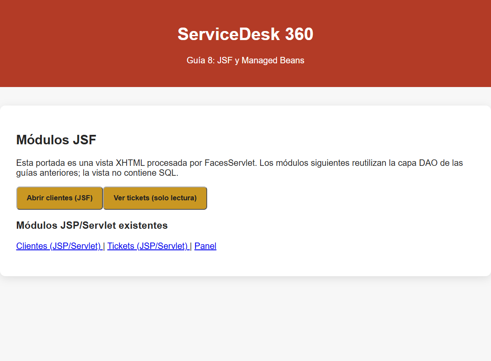

Muestra la portada `/index.xhtml`, los botones “Abrir clientes (JSF)” y “Ver
tickets (solo lectura)”, y los enlaces a los módulos JSP/Servlet existentes.

### 12.2 Listado de clientes


Muestra la tabla de clientes con el cliente id 7. Esta captura se tomó
después de reiniciar Tomcat, por lo que también sirve como evidencia de
persistencia.

### 12.3 Formulario de alta

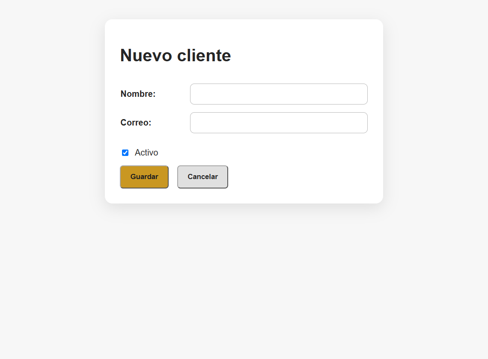

Muestra el formulario vacío de “Nuevo cliente”, con el campo Activo marcado.

### 12.4 Validación de correo duplicado

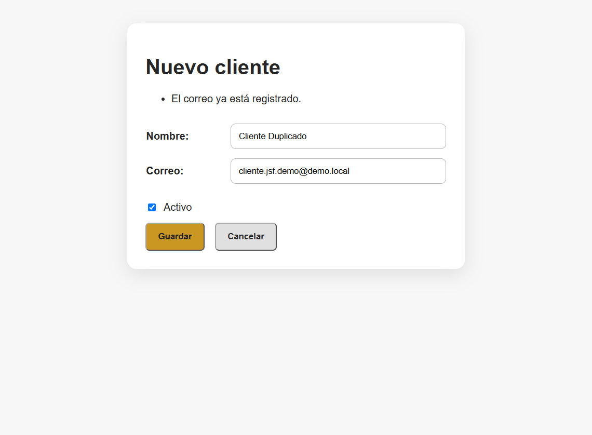

Muestra el mensaje “El correo ya está registrado.” al intentar reutilizar
`cliente.jsf.demo@demo.local`.

### 12.5 Edición de cliente

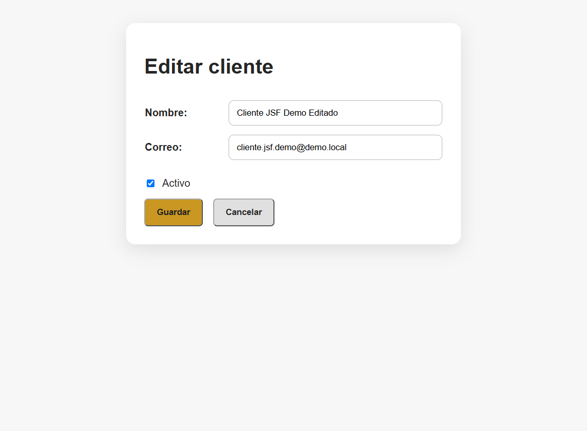

Muestra el formulario “Editar cliente” cargado desde
`/views/clientes/formulario.xhtml?id=7`, con los datos obtenidos de MySQL.

### 12.6 Vista JSF de tickets

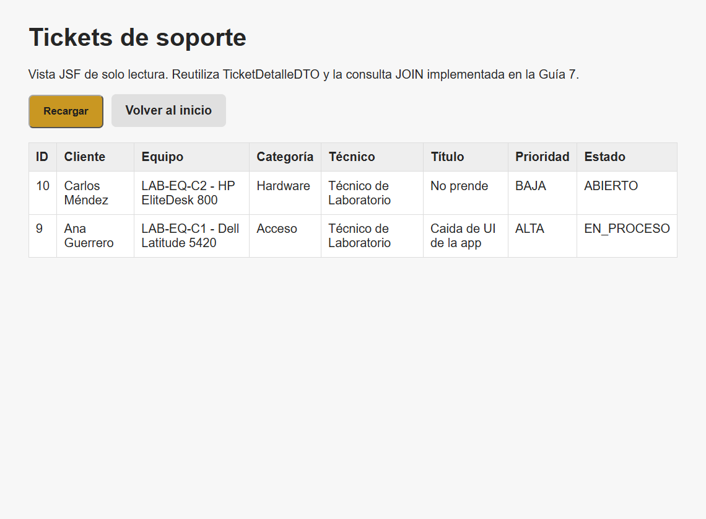

Muestra la tabla de tickets de solo lectura, con cliente, equipo, categoría,
técnico, título, prioridad y estado.

### 12.7 Validación de campos obligatorios

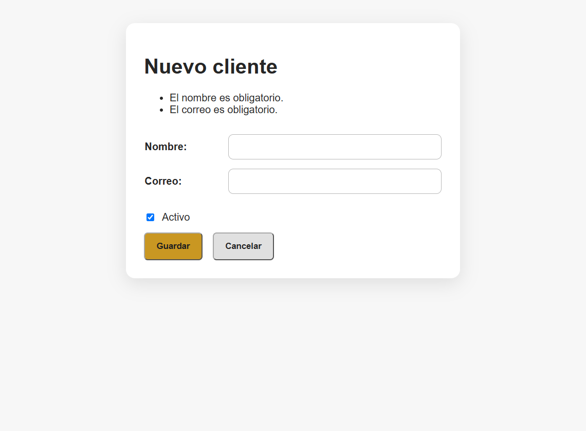

Muestra los mensajes de `required` al intentar guardar con nombre y correo
vacíos. La acción `guardar()` no se ejecutó.

### 12.8 Actualización exitosa

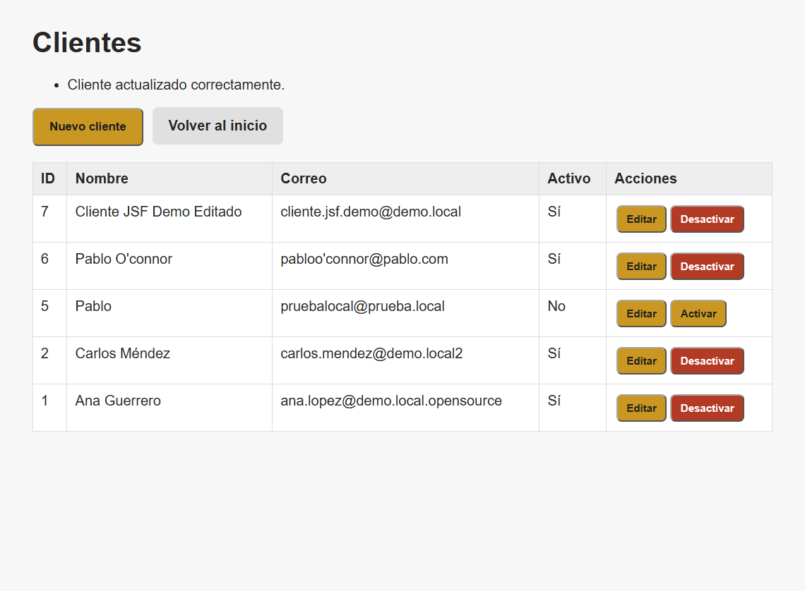

Muestra el mensaje “Cliente actualizado correctamente.” después de guardar el
formulario de edición y volver al listado.

### 12.9 Desactivación lógica

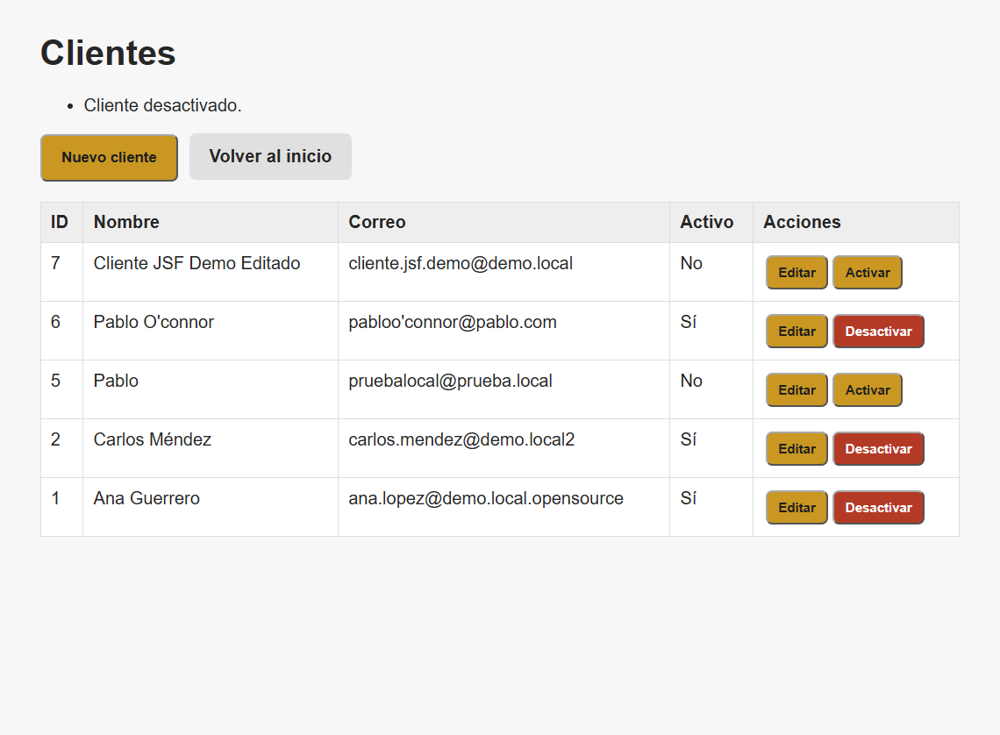

Muestra “Cliente desactivado.”, el cliente id 7 con Activo = “No” y el botón
“Activar” en lugar de “Desactivar”. Después de la captura se reactivó el
cliente para dejar los datos de prueba activos.

### 12.10 Comparación: listado JSP/Servlet

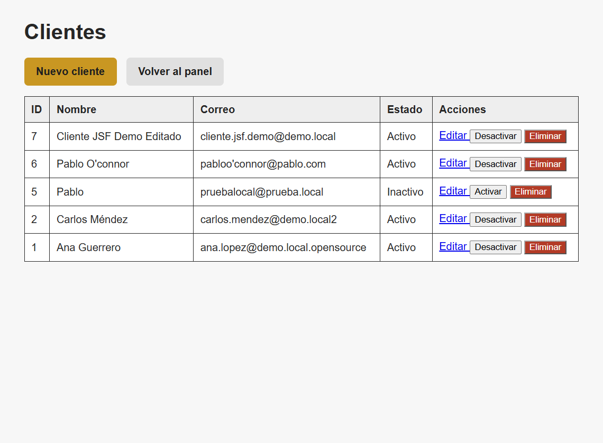

Muestra el listado clásico de `/clientes` con la misma información de clientes
y las acciones de Servlet/JSP. Sirve para comparar el enfoque anterior con la
tabla JSF.

### 12.11 Comparación: listado JSF

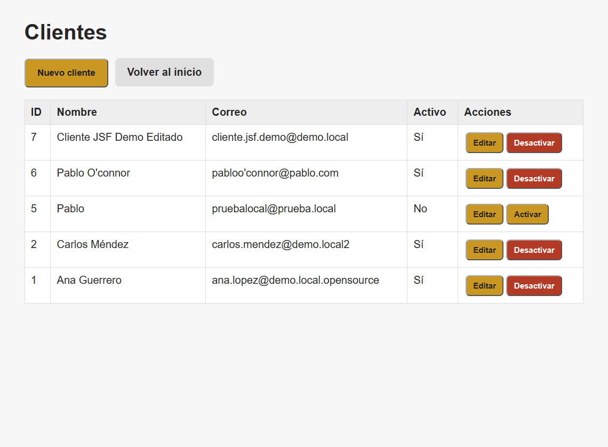

Muestra la misma información en `/views/clientes/lista.xhtml`, con la tabla
JSF, el estado Activo = “Sí/No” y los botones de acción propios del Managed
Bean.

### 12.12 Integración con el panel

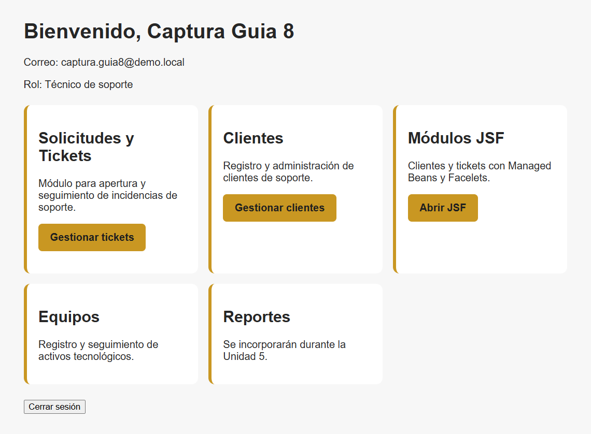

Muestra el panel autenticado con la tarjeta “Módulos JSF” y el botón “Abrir
JSF”. Se comprobó con una cuenta temporal creada para la validación; el panel
JSP compila y muestra el enlace correctamente.

## 13. Guion de capturas para el informe

La siguiente tabla resume el guion completo. Las capturas marcadas como
**Generada** ya existen en `docs/capturas/`; las marcadas como **Pendiente**
son las que conviene agregar para completar el informe. Usar una resolución de
1280×720 o 1366×768, incluir la barra de direcciones cuando sea posible y
guardar todo en `docs/capturas/`.

| # | Archivo | Estado | Momento / pantalla | Qué debe verse | Por qué |
|---:|---|---|---|---|---|
| 01 | `01-portada-jsf.png` | Generada | `/index.xhtml` | Título “ServiceDesk 360”, “Guía 8: JSF y Managed Beans” y los dos botones | Demuestra que FacesServlet procesa XHTML. |
| 02 | `02-lista-clientes-jsf.png` | Generada | `/views/clientes/lista.xhtml` | Tabla con id 7, nombre, correo, Activo y acciones | Demuestra el listado desde MySQL. |
| 03 | `03-formulario-nuevo.png` | Generada | Botón “Nuevo cliente” | Formulario vacío, checkbox Activo marcado | Demuestra el alta. |
| 04 | `04-validacion-correo-duplicado.png` | Generada | Reintentar con el mismo correo | “El correo ya está registrado.” y el formulario conservando los datos | Demuestra la validación de unicidad. |
| 05 | `05-editar-cliente.png` | Generada | Botón “Editar” del cliente 7 | Formulario “Editar cliente” con los datos cargados y, si es posible, la URL `?id=7` | Demuestra `f:viewParam` + `f:viewAction`. |
| 06 | `06-tickets-jsf.png` | Generada | `/views/tickets/lista.xhtml` | Tabla con tickets, cliente, equipo, técnico, prioridad y estado | Demuestra la vista de solo lectura y la reutilización del JOIN. |
| 07 | `07-validacion-required.png` | Generada | Guardar con nombre y correo vacíos | “El nombre es obligatorio.” y “El correo es obligatorio.” | Demuestra la fase de validación antes de la acción. |
| 08 | `08-actualizacion-exitosa.png` | Generada | Guardar la edición | “Cliente actualizado correctamente.” y el nombre actualizado | Demuestra el `UPDATE` y el mensaje flash. |
| 09 | `09-desactivacion-logica.png` | Generada | Botón “Desactivar” y aceptar el diálogo | “Cliente desactivado.”, Activo = “No”, botón “Activar” | Demuestra la desactivación lógica, no física. |
| 10 | `10-cliente-creado.png` | Pendiente | Después de guardar un cliente nuevo | Mensaje “Cliente registrado correctamente.” y la fila nueva en la tabla | Demuestra el `INSERT` y el mensaje flash. |
| 11 | `11-reactivacion.png` | Pendiente | Botón “Activar” | “Cliente activado.” y Activo = “Sí” | Demuestra que el registro sigue existiendo y se puede reactivar. |
| 12 | `12-persistencia-reinicio.png` | Pendiente | Después de reiniciar Tomcat; volver a abrir el listado | Cliente id 7 y nombre actualizado | Demuestra que el dato está en MySQL, no solo en memoria. |
| 13 | `13-mysql-select.png` | Pendiente | MySQL Workbench o consola | Consulta `SELECT ... WHERE id_cliente = 7;` y el resultado | Compara la vista JSF con la base de datos. |
| 14 | `14-tomcat-jsf.png` | Pendiente | Log de arranque de Tomcat | Líneas “Initialize Weld”, “WELD-000900: 3.1.9”, “Initializing Mojarra 2.3.21” y ausencia de errores de despliegue | Demuestra la implementación JSF/CDI utilizada. |
| 15 | `15-clientes-jsp.png` | Generada | `/clientes` | Listado JSP/Servlet clásico | Permite comparar con la vista JSF. |
| 16 | `16-clientes-jsf-comparacion.png` | Generada | `/views/clientes/lista.xhtml` | Misma información en JSF | Pareja de la captura anterior para la comparación. |
| 17 | `17-panel-jsf.png` | Generada | `/panel` autenticado | Tarjeta “Módulos JSF” y botón “Abrir JSF” | Demuestra la integración con el panel existente. |
| 18 | `18-codigo-cliente-bean.png` | Pendiente | IDE abierto en `ClienteBean.java` | `@Named`, `@ViewScoped`, `@PostConstruct`, `Serializable` y métodos | Evidencia de código para la explicación. |
| 19 | `19-codigo-xhtml.png` | Pendiente | IDE abierto en `lista.xhtml` o `formulario.xhtml` | `h:dataTable`, `h:messages`, `h:form`, `f:viewParam` | Evidencia de la vista Facelets. |
| 20 | `20-estructura-proyecto.png` | Pendiente | Árbol del proyecto | `bean/`, `views/`, `faces-config.xml`, `beans.xml`, `web.xml` | Evidencia de la organización del proyecto. |

### Orden recomendado para presentar las capturas

1. Portada JSF.
2. Listado de clientes.
3. Formulario de alta.
4. Cliente creado con mensaje de éxito.
5. Validación de correo duplicado.
6. Validación de campos obligatorios.
7. Formulario de edición.
8. Actualización exitosa.
9. Desactivación lógica y reactivación.
10. Vista JSF de tickets.
11. Persistencia después de reiniciar Tomcat.
12. Consulta MySQL.
13. Log de Tomcat con Mojarra y Weld.
14. Comparación JSP/Servlet vs JSF.
15. Código del bean y de la vista.
16. Estructura del proyecto.

### Consejos para que las capturas sirvan como comprobante

- Mostrar la URL cuando la captura sea de una página web. Si la herramienta
  no captura la barra del navegador, tomar la captura con la ventana completa.
- No recortar los mensajes de éxito o error: son la evidencia de la fase de
  validación y de la acción ejecutada.
- En la captura de edición, que se vea el nombre cargado y, si es posible,
  `?id=7` en la URL.
- En la captura de desactivación, que se vea el diálogo de confirmación o la
  fila con Activo = “No” y el botón “Activar”.
- Tomar la captura de persistencia **después** de detener y volver a iniciar
  Tomcat, no solo después de guardar.
- En MySQL Workbench, mostrar la consulta y la cuadrícula de resultados en la
  misma imagen. No mostrar contraseñas ni cadenas de conexión.
- En el log, recortar solo las líneas relevantes de Mojarra/Weld y evitar
  incluir rutas personales innecesarias.
- Usar siempre el mismo cliente de prueba (`id 7`) para que las capturas sean
  comparables.
- Guardar las imágenes con los nombres sugeridos; así el informe y este
  documento coinciden.

## 14. Limitaciones y observaciones

1. **Vistas públicas en `/views`:** la guía propone `WEB-INF/views`, pero el
   postback de JSF apunta a la ruta de la vista y Tomcat bloquea `/WEB-INF`.
   Se priorizó un flujo funcional. Si se requiere protección estricta, se
   puede implementar un `ViewHandler` con URLs públicas que resuelvan a
   vistas internas, o mover la seguridad a un filtro/Spring Security.
2. **Aviso de cierre de Mojarra/Weld:** al detener Tomcat puede aparecer un
   `SEVERE` de `ConfigureListener.contextDestroyed`. Ocurre por el orden de
   destrucción de los listeners de Mojarra y Weld; no afecta el arranque ni
   las operaciones. En el arranque limpio se observan Weld 3.1.9 y Mojarra
   2.3.21 funcionando.
3. **Advertencia de Jandex:** Weld indica que usa reflexión para el
   descubrimiento `annotated` y sugiere agregar Jandex para acelerar el
   arranque. Es solo una advertencia de rendimiento.
4. **Prioridad CRÍTICA:** sigue bloqueada por la restricción
   `tickets.chk_ticket_prioridad` de MySQL. No forma parte de la Guía 8.
5. **Servlet de clientes:** se conserva `ClienteServlet` y las vistas JSP para
   la comparación solicitada. No se eliminó la ruta anterior.

## 15. Comandos útiles

```powershell
# Compilar
cd C:\servicedesk360\ServiceDesk360
& "C:\Program Files\Apache NetBeans\java\maven\bin\mvn.cmd" clean package -DskipTests

# Reiniciar Tomcat
$env:JAVA_HOME = "C:\Program Files\Java\jdk-25"
& "C:\apache-tomcat-9.0.120\bin\shutdown.bat"
& "C:\apache-tomcat-9.0.120\bin\startup.bat"

# Abrir la portada JSF
Start-Process "http://localhost:8080/ServiceDesk360/index.xhtml"
```

## 16. Conclusión

La Guía 8 quedó implementada con JSF 2.3 sobre Tomcat 9, usando Mojarra y
Weld para respetar el enfoque `@Named`/`@ViewScoped` de la guía. El CRUD de
clientes funciona con validaciones, mensajes, navegación y persistencia real
en MySQL. La vista de tickets reutiliza el DTO y el JOIN de la Guía 7 sin
duplicar SQL. El módulo Servlet/JSP se mantiene para comparar ambos enfoques y
la documentación incluye un guion completo de capturas para el informe.
